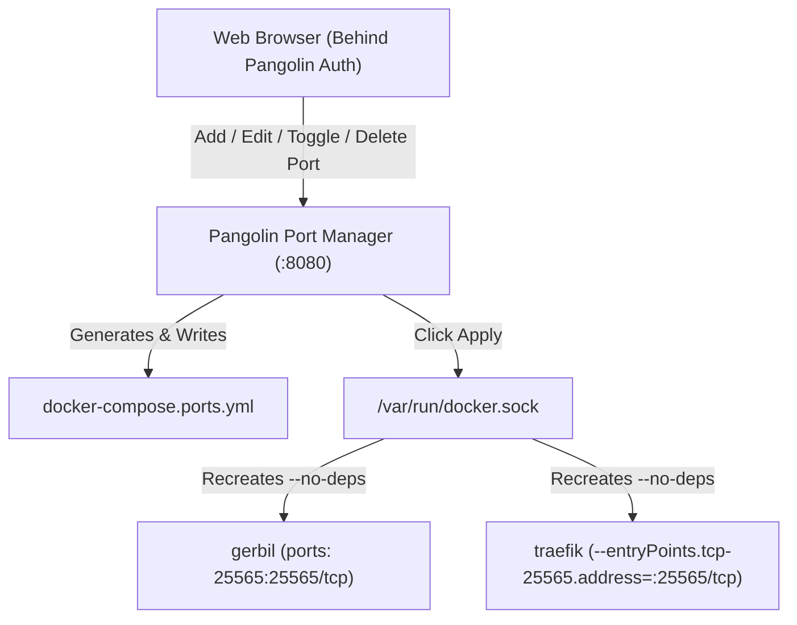

# Pangolin Port Manager

A lightweight Go microservice with an embedded Web UI (HTMX + custom dark mode aesthetic matching Pangolin) designed to sit behind Pangolin authentication to manage raw TCP/UDP port exposure on Gerbil and Traefik entrypoints.

---

## ⚡ Why This Exists & How It Works

In a Pangolin stack, Traefik shares Gerbil's network stack via `network_mode: service:gerbil`. Because Docker prevents containers with shared network modes from exposing ports directly:
1. **All host port forwards must be defined on Gerbil** (`ports: ["25565:25565/tcp"]`).
2. **Traefik requires static CLI flags or entrypoints** to bind listeners to those ports (`--entryPoints.tcp-25565.address=:25565/tcp`).

Pangolin Port Manager automates this workflow:
- Provides a clean, responsive dark-mode Web UI to manage your TCP and UDP ports.
- Generates an isolated compose override file (`docker-compose.ports.yml`).
- Automatically detects drift between your configured rules and the applied compose file.
- Provides a one-click **"Apply Changes & Restart Traefik"** action that recreates `gerbil` and `traefik` with `--no-deps` via the Docker socket, without restarting the rest of your stack.



---

## 🚀 Quick Start

### 1. Add `pangolin-port-manager` to your `compose.yml`

In your Pangolin stack's compose file (e.g., `compose.yml` or `compose.example.yml`), add the `pangolin-port-manager` service:

```yaml
services:
  # ... your existing pangolin, gerbil, and traefik services ...

  pangolin-port-manager:
    build: . # or image: ghcr.io/your-user/pangolin-port-manager:latest
    container_name: pangolin-port-manager
    restart: unless-stopped
    environment:
      - PORT=8080
      - COMPOSE_PROJECT_DIR=/compose
      - COMPOSE_OUT_PATH=/compose/docker-compose.ports.yml
      - COMPOSE_FILES=compose.yml,docker-compose.ports.yml
      - GERBIL_SERVICE_NAME=gerbil
      - TRAEFIK_SERVICE_NAME=traefik
      - TRAEFIK_BASE_COMMANDS=--configFile=/etc/traefik/traefik_config.yml,--api.insecure=true,--api.dashboard=true
    volumes:
      - ./data/provisioner:/data
      - .:/compose
      - /var/run/docker.sock:/var/run/docker.sock
    labels:
      - "traefik.enable=true"
      - "traefik.http.routers.provisioner.rule=Host(`ports.yourdomain.com`)"
      - "traefik.http.routers.provisioner.entrypoints=websecure"
      - "traefik.http.routers.provisioner.tls.certresolver=letsencrypt"
      - "traefik.http.services.provisioner.loadbalancer.server.port=8080"
```

> **Note on Compose V2**: We recommend passing multiple compose files via `COMPOSE_FILES=compose.yml,docker-compose.ports.yml` rather than using the top-level `include:` directive in your base compose file, which can cause resource conflict warnings in Docker Compose when both files define the same services (`gerbil` and `traefik`).

### 2. Start the Stack

```bash
docker compose -f compose.yml -f docker-compose.ports.yml up -d --build
```

Access the dashboard at `https://ports.yourdomain.com` (or `http://localhost:8080` if accessing locally).

---

## 📁 Understanding Volume Mounts

```yaml
volumes:
  - ./data/provisioner:/data
  - .:/compose
  - /var/run/docker.sock:/var/run/docker.sock
```

### Why `./data/provisioner:/data`?
Persists the application state (`ports.json`) containing your port definitions, names, protocols, and enabled/disabled states across container rebuilds.

### Why `.:/compose`?
The `docker compose` CLI runs **inside** the `pangolin-port-manager` container and communicates with the host's Docker daemon via `/var/run/docker.sock`. 
1. **Reading the Base Config**: The CLI inside the container needs to read `compose.yml` to know how `gerbil` and `traefik` are configured.
2. **Writing the Override**: The provisioner needs to write `docker-compose.ports.yml` to the directory on the host so both the container and future host commands can access it.
3. **Resolving Relative Paths**: When Docker Compose recreates `gerbil`, it resolves relative volume paths (like `./config:/var/config`). `pangolin-port-manager` automatically inspects its own mounts to detect your host project path and preserves correct host path resolution.

#### Prefer not to mount the whole `.` directory?
If you want to restrict container filesystem access, you can mount only a dedicated subfolder or specific files:
```yaml
volumes:
  - ./data/provisioner:/data
  - ./compose.yml:/compose/compose.yml:ro
  - ./docker-compose.ports.yml:/compose/docker-compose.ports.yml
  - /var/run/docker.sock:/var/run/docker.sock
```
*(Ensure `touch docker-compose.ports.yml` exists on the host before running, otherwise Docker will create it as a directory).*

---

## ⚙️ Environment Variables

| Variable | Default | Description |
|---|---|---|
| `PORT` | `8080` | HTTP port the server listens on |
| `DATA_DIR` | `./data` | Directory for persistent storage (`ports.json`) |
| `PORTS_FILE_PATH` | `./data/ports.json` | Explicit path to the ports JSON file |
| `COMPOSE_PROJECT_DIR` | `/compose` | Project directory for `docker compose` commands |
| `COMPOSE_OUT_PATH` | `./docker-compose.ports.yml` | Output path for generated compose override file |
| `COMPOSE_FILES` | `compose.example.yml,docker-compose.ports.yml` | Comma-separated list of compose files passed with `-f` |
| `GERBIL_SERVICE_NAME` | `gerbil` | Name of the Gerbil service in your compose file |
| `TRAEFIK_SERVICE_NAME` | `traefik` | Name of the Traefik service in your compose file |
| `TRAEFIK_BASE_COMMANDS` | `--configFile=...,--api.insecure=true...` | Base static Traefik CLI arguments to preserve |

---

## 🛠️ API Reference

| Method | Endpoint | Description |
|---|---|---|
| `GET` | `/` | Web UI Dashboard |
| `GET` | `/healthz` | Health check (`200 OK`) |
| `GET` | `/api/ports` | List all configured port rules (JSON) |
| `POST` | `/api/ports` | Create a new port rule (`{ "name": "Minecraft", "port": 25565, "protocol": "tcp", "enabled": true }`) |
| `PUT` | `/api/ports/{id}` | Update an existing rule's name, port, protocol, or state |
| `POST` | `/api/ports/{id}/toggle` | Toggle rule enabled/disabled state |
| `DELETE` | `/api/ports/{id}` | Delete a port rule |
| `POST` | `/api/apply` | Generate compose override and trigger container recreation |

---

## 📦 Docker Image & CI/CD

Pre-built multi-arch (`linux/amd64`, `linux/arm64`) images are built and published to GitHub Container Registry (GHCR) automatically via GitHub Actions:

```yaml
services:
  pangolin-port-manager:
    image: ghcr.io/<your-github-username>/pangolin-port-manager:latest
```

The GitHub Actions workflow [`.github/workflows/docker-publish.yml`](.github/workflows/docker-publish.yml):
1. Runs all unit and integration tests.
2. Builds multi-architecture images natively for `amd64` and `arm64` using Docker Buildx and Go cross-compilation.
3. Automatically publishes tags on `main` branch pushes and semantic version Git tags (`v1.0.0`).

---

## 🧪 Testing

Run all unit and E2E tests:

```bash
go test -v ./...
```

Run Playwright browser integration tests:

```bash
python3 -m unittest tests/playwright_e2e.py
```
